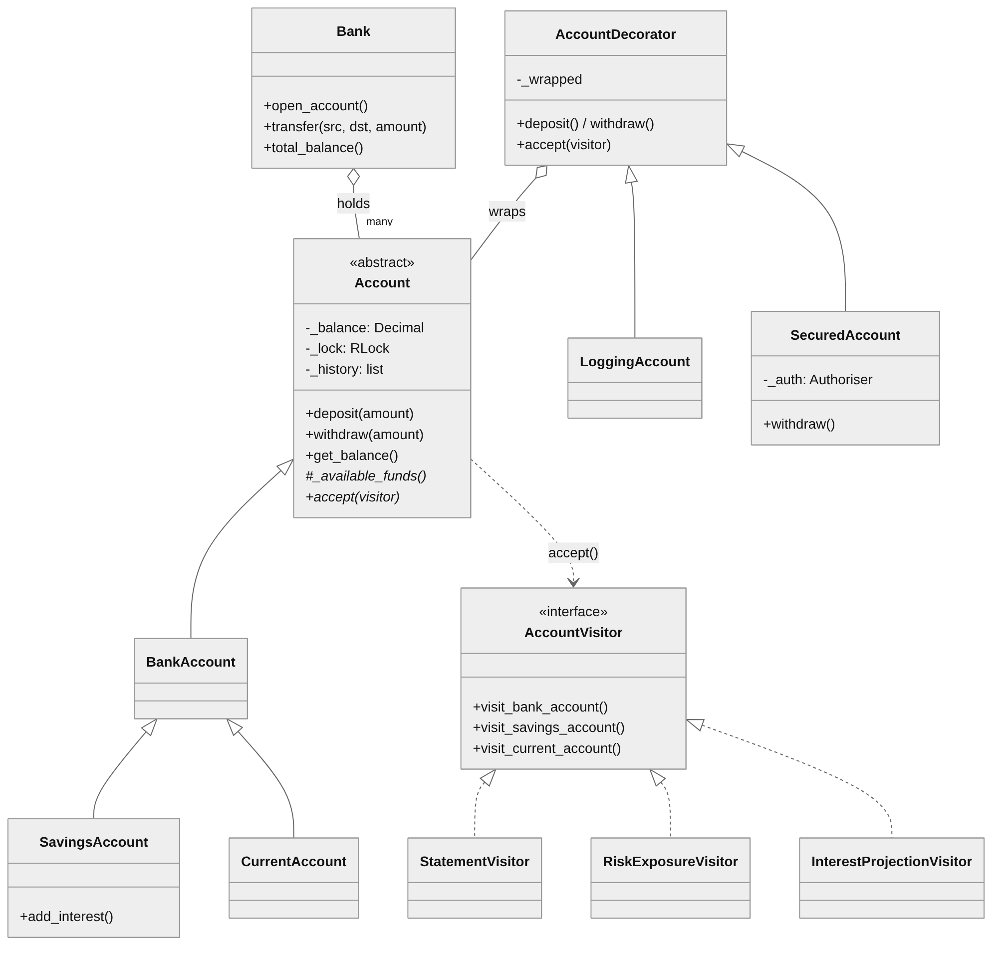
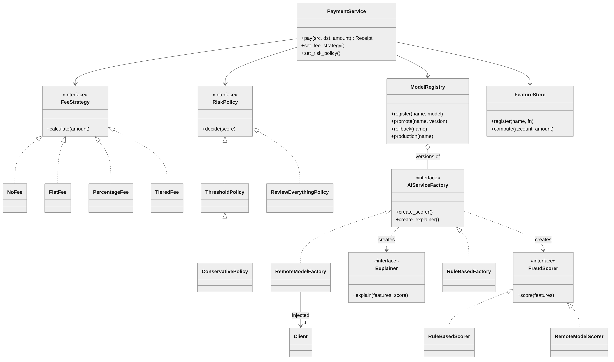
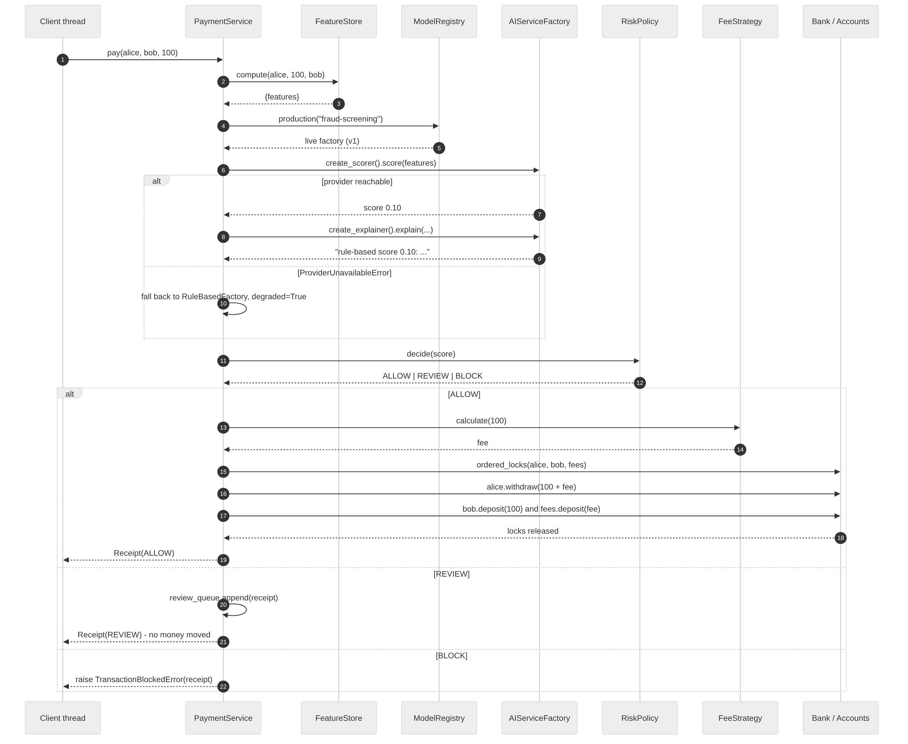

# Capstone Project — Advanced Object-Oriented Design and Programming

This page holds the four Capstone tasks of my e-Portfolio for the module. The source code is in [`code/`](code/), the diagrams in [`figures/`](figures/), and the full written submission (reflective piece + these tasks) is [`e-Portfolio Report.docx`](e-Portfolio Report.docx).

**Contents:** [Task 1](#task-1--summary-of-key-learning-outcomes) · [Task 2](#task-2-artefacts-and-critical-commentary) · [Task 3](#task-3-reflection-on-skill-development) · [Task 4](#task-4-professional-development-plan) · [References](#references)

## How to run

```text
python main.py                       # Demonstrations 1-4 (coding exercise)
python deadlock_experiment.py        # reproduces the two locking faults
python demo_patterns.py              # Demonstrations 5-9 (patterns + capstone)
python -m unittest test_bank_system.py test_patterns.py -v   # 49 tests
```
Python 3.10 or later; no third-party packages.

## Task 1 – Summary of key learning outcomes

Table 1 maps each learning objective to the practical work that evidences it. Artefact numbers (A1–A8) refer to Task 2.

| Learning objective | How it was achieved | Evidence |
|---|---|---|
| LO1 Understand and implement secure coding practices | A single validation function is applied to all monetary values, rejecting any negatives, zero, NaN or infinity and making a Decimal conversion prior to a change of state. Balances are kept private and can be accessed in no other way than through locked methods. The SecuredAccount decorator brings in authorisation and will lock out after a run of failures; the LoggingAccount decorator leaves an audit trail of calls, whether they were successful or not. Should the remote model be out of reach the AI provider has a deterministic fallback and marks the receipt as degraded, failing safe rather than open. | A1 (validation, encapsulation), A3 (security and audit decorators), A5/A8 (fail-safe fallback), tests T01–T04, P08–P10, P28 |
| LO2 Apply advanced OO principles to complex problems | The design makes use of abstraction (the abstract Account), encapsulation (private state, read-only properties and history copies) and polymorphism (a single withdraw() covering three funding rules by way of Template Method). Inheritance is shared for locking and validation among the three account products. In Bank, the decorators and PaymentService composition is favoured over inheritance. As for dependency inversion, the PaymentService is dependent on nothing but abstract factories and strategies. | A1, A8; class diagrams Figures 1–2 |
| LO3 Utilise design patterns for reusable, maintainable, flexible code | Pricing rules and the AI decision policy are handled by a strategy that can be swapped at runtime. For logging and security the stackable Decorator is employed to avoid a proliferation of subclasses. A Visitor takes care of statements, risk exposure and interest projection, allowing new reports to be put together without disturbing the concurrency-critical classes. An Abstract Factory is used for the scorer/explainer families so that a registry version can be promoted to switch the provider. Every artefact documents the trade-off of the pattern. | A2–A5, Demonstrations 5–8, tests P01–P20 |
| LO4 Design architectures for large-scale systems, ensuring security and robustness | As shown in Figures 2 and 3, the architecture of the PaymentService has been set up to separate money movement, pricing, feature computation, model selection and risk policy into parts that can be replaced independently. Robustness is in evidence from the concurrent end-to-end run (Demonstration 9: 360 payments screened on six threads with the money conserved to the penny) and the one ordered_locks() function which ensures multi-account locking is free of deadlocks. | A8, Demonstration 9, sequence diagram Figure 3, tests T05–T13 |
| LO5 Develop solutions adaptable for AI models and efficient for data-science tasks | To ensure training and serving have a common definition, the FeatureStore defines, names and versions the features for a model. The ModelRegistry does the same for providers, with an audit trail for promotions and roll backs. The scorer is presented with a plain feature dictionary, not an account object. In tests the live model is stood in for by mocks to allow the AI-dependent path to be tested in its entirety offline. | A6, A7, Demonstration 8, tests P21–P30 |


### Advanced design patterns: in practice

Every pattern put to use here was to address a particular pressure in the banking system. Strategy gives the runtime behavioural flexibility; as seen in Demonstration 5, the fee rule is altered from NoFee to PercentageFee in the course of the service running and the next payment is priced accordingly, all without a restart or any modification to the service. Decorator and Visitor see to the separation of concerns. Logging, authorisation and reporting are kept outside the Account hierarchy so it remains as well tested as when the coding exercise was done. Abstract Factory is the means for scalability and extensibility: to put in a new AI provider one need only add a factory class and make a registry promotion, PaymentService is left unedited. The costs of each artefact are as follows: with Visitor a fourth product comes at a price, Decorator makes identity more involved, and Strategy will introduce classes where a function might have sufficed.


### AI-oriented OO patterns: a matter of concept

In keeping with ML engineering I have put two architectural patterns in place in a deliberately small way. The Model Registry is for the versioning and lifecycle of models, to register them, promote to production, put the old version in archive, roll back and have a record of who did what. The Feature Store has the feature definitions in one place so the identical code can be used at training and serving time; this does away with the training/serving skew that Sculley et al. (2015) consider a prime source of hidden technical debt in ML systems. Both run in memory. For a coursework artefact that is the proper level of abstraction. A database-backed version would not alter anything above the interfaces on which the rest of the system relies.


## Task 2: Artefacts and critical commentary

The artefacts in this project are all Python 3 modules. They are set out in Table 2 and the complete source has been submitted with this document and put on the e-Portfolio. In the section for every artefact one will find its purpose, the OO principles and pattern at play, the reasoning behind the pattern selection and how it serves to make the code more maintainable, extensible or testable. The challenges and trade-offs encountered are also covered.

| Artefact | Files | Pattern / technique | Tests |
|---|---|---|---|
| A1 Thread-safe banking system (individual coding exercise) | bank_account.py, bank.py, simulator.py, main.py, deadlock_experiment.py | Abstraction, encapsulation, inheritance, polymorphism; Template Method; Facade; re-entrant locks; ordered locking | test_bank_system.py (19 tests, T01–T17) |
| A2 Pricing rules and AI decision policy | strategies.py | Strategy | P01–P06 |
| A3 Logging and security layers | decorators.py | Decorator | P07–P12 |
| A4 Statements and analytics | visitors.py | Visitor (double dispatch) | P13–P16 |
| A5 Switchable AI providers | ai_providers.py | Abstract Factory; dependency injection | P17–P20 |
| A6 Model Registry and Feature Store | ml_platform.py | AI-oriented architectural patterns | P21–P24 |
| A7 Mock-based and AI-assisted testing | test_patterns.py | unittest.mock (Mock, MagicMock, patch, spec) | P25–P30 |
| A8 Capstone: screened payment service | payments.py, demo_patterns.py | Composition of A1–A6; atomic multi-account operations | Demonstrations 5–9; all 49 tests |

**How to run (Python 3.10 or later; no third-party packages):**

```text
$ python main.py                       # Demonstrations 1-4
$ python deadlock_experiment.py        # the two locking faults
$ python demo_patterns.py              # Demonstrations 5-9
$ python -m unittest test_bank_system.py test_patterns.py -v   # 49 tests
```


### A1: Thread-safe banking system (coding exercise)

The object. We have an abstract Account with three products, a Bank to do the transfers and a TransactionSimulator that puts shared accounts through their paces with multiple threads. The exercise called for resolving a lost-update race and a transfer deadlock as well as ensuring consistent reads.

Principles. Access to the balance is private and can be had only via methods under the account’s re-entrant lock; check-then-act is done in a single critical section. withdraw() is a Template Method which hands off the one variable part, _available_funds(), to the subclass while the Bank acts as a Facade for two-lock transfers.

```python
    def withdraw(self, amount):
        """Deduct an amount from the balance if funds allow (thread-safe)."""
        amount = validate_amount(amount)
        with self._lock:
            available = self._available_funds()      # polymorphic rule
            if amount > available:
                raise InsufficientFundsError(……)
            self._balance -= amount
            self._record("WITHDRAW", amount)
            return self._balance
```

**Challenges:** The initial transfer was a case in point: with nothing but a threading.Lock to go on, it would deadlock on itself. transfer() would have the account lock and then call withdraw(), which would attempt to claim it once more. I was unable to get the fault to show up at will until I put together deadlock_experiment.py for the express purpose of making the system fail. An RLock and a global lock order by account number did the trick. For the Capstone I made use of an ordered_locks() context manager in every multi-account operation to handle that ordering; it is a refactoring that eliminates any duplicate code and the possibility of two orderings being at odds.

**Trade-offs:** Having a separate lock for each account means unrelated customers do not have to wait on one another, though it does require an ordering discipline. Semaphores and condition variables were put aside for the reasons given in the exercise report. As Demonstration 2 makes clear, 87 per cent of deposits are lost in the absence of the lock, whereas there are none with it.

```text
$ python3 main.py
……………
==================================================================
DEMONSTRATION 2: Why the lock is needed (race condition)
==================================================================
8 threads each deposit 1.00, 250 times.
Expected balance             : 2000.00
Without a lock (UnsafeAccount): 297.00  <-- 1703.00 lost
With a lock (BankAccount)     : 2000.00  <-- correct

The GIL does not make this safe: 'balance = balance + amount' is
three separate steps and a thread can be interrupted between them.

==================================================================
DEMONSTRATION 3: Concurrent transactions (TransactionSimulator)
==================================================================
Users (threads)        : 5
Operations per user    : 400
Deposits               : 512
Withdrawals            : 484 (28 declined)
Transfers              : 448 (29 declined)
Total deposited        : 12664.18
Total withdrawn        : 12081.63
Opening total          : 600.00
Expected closing total : 1182.55
Actual closing total   : 1182.55
Difference             : 0.00
Threads still running  : 0
Time taken             : 0.005 seconds
RESULT                 : PASS - balances agree

Final position of each account:
  BankAccount(ACC005, User1, balance=544.01)
  BankAccount(ACC006, User2, balance=98.67)
  BankAccount(ACC007, User3, balance=539.87)
……………
```

```text
$ python3 deadlock_experiment.py

Evidence for the locking decisions in Bank.transfer()

==================================================================
EXPERIMENT A: threading.Lock vs threading.RLock
==================================================================
Plain Lock  : FAILED - withdraw() could not acquire the lock
              The thread is waiting for a lock it already
              holds. This is self-deadlock.
RLock       : re-acquired by the same thread = True
DECISION    : RLock is used in Account, so transfer() can hold the
              lock and still call withdraw() and deposit().

==================================================================
EXPERIMENT B: unordered locking vs ordered locking
==================================================================
Unordered locking : 1 thread(s) blocked
                    DEADLOCK: holding ACC002, cannot get ACC001
                    total in the two accounts: 2000
Ordered locking   : 0 thread(s) blocked
                    total in the two accounts: 2000
DECISION          : Bank.transfer() sorts the two accounts by
                    account number before locking.

==================================================================
SUMMARY
==================================================================
  Experiment A (RLock required)        : demonstrated
  Experiment B (ordered locking needed): demonstrated
```


### A2: Strategy: pricing rules and AI decision policy

There is the object and two sets of algorithms that can be interchanged. The cost of a transfer is determined by the FeeStrategy, which includes NoFee, FlatFee, PercentageFee (with floor and cap) and TieredFee. As for what to do with a fraud score, whether to allow it, put it in a queue for human review or block it, that is the province of the RiskPolicy (ThresholdPolicy, ConservativePolicy, ReviewEverythingPolicy). The PaymentService has one of each on hand and will swap them out as it runs.

```python
class RiskPolicy(ABC):
    @abstractmethod
    def decide(self, score):
        """Map a score in [0, 1] to an Action."""

class ThresholdPolicy(RiskPolicy):
    def __init__(self, review="0.40", block="0.80"): ...
    def decide(self, score):
        score = self._check(score)             # rejects NaN, <0, >1
        if score >= self._block:  return Action.BLOCK
        if score >= self._review: return Action.REVIEW
        return Action.ALLOW

# runtime swap - no restart, no change to PaymentService
service.set_fee_strategy(PercentageFee("0.02"))
service.set_risk_policy(ConservativePolicy())
```

The case for Strategy. In the service my initial version had an if/elif on a fee_type string, so to put in a new rule one had to edit and re-test the service, while the rule in effect was not visible at runtime. Using Strategy means every rule is a small class with its own tests (P01–P02). The service’s tests are left alone when a rule is introduced (Open/Closed) and the active rule is an object that can be inspected, something of importance for audit purposes. There is also an AI-specific advantage to keeping the policy separate from the model: during a fraud wave thresholds can be made more stringent without retraining (see Demonstration 5 where a 0.70 score is REVIEW by one policy and BLOCK by another) and a model can be swapped out with no effect on the thresholds.

As for trade-offs, it is fair to say that four fee classes could be four lambdas. I have stuck with classes since the rules have validated state to show in the audit output, such as floors, caps and tier tables, and they are named accordingly. ReviewEverythingPolicy is but two lines yet it puts a safety decision on the table explicitly instead of leaving it implicit.

```text
$ python3 demo_patterns.py 5

======================================================================
DEMONSTRATION 5 - Strategy: pricing rules and AI decision policy
======================================================================
  NoFee            fee on 250.00: 0.00
  FlatFee          fee on 250.00: 1.50
  PercentageFee    fee on 250.00: 3.75
  TieredFee        fee on 250.00: 2.50

  Same score, different policy -> different action:
    score 0.15: ThresholdPolicy -> ALLOW  ConservativePolicy -> ALLOW
    score 0.45: ThresholdPolicy -> REVIEW ConservativePolicy -> REVIEW
    score 0.70: ThresholdPolicy -> REVIEW ConservativePolicy -> BLOCK

  Pay 50 under NoFee        -> fee account 0.00
  Pay 50 under PercentageFee -> fee account 1.00
```


### A3: Decorator: for the logging and security layers

AccountDecorator is an object that will wrap any account and pass on all calls. LoggingAccount puts in an audit line on top of every deposit and withdrawal, even those that are turned down, and notes the calling thread. SecuredAccount will not allow a withdrawal unless the owner is the one logged in and it will put the account under lock for some time after too many failures. In what order they are stacked makes no difference to the outcome when Bank.transfer() is used.

```python
alice = SecuredAccount(LoggingAccount(bank.open_account("Alice", 500)),
                       authoriser, max_failures=2, lockout_seconds=30)

class SecuredAccount(AccountDecorator):
    def withdraw(self, amount):
        self._check_permission()           # raises PermissionDeniedError
        return self._wrapped.withdraw(amount)

class AccountDecorator:
    def __getattr__(self, name):           # owner, account_number, lock ...
        return getattr(self._wrapped, name)
```

The reason for the decorator pattern is that logging and authorisation are cross-cutting. To have them inside Account would be to conflate three responsibilities in a class whose concurrency I had put in the most work to get right. With subclassing there are four variants per product (twelve classes), whereas with decorators two will do for the same mix and each can be tested on its own using a MagicMock logger (P08) or a stub authoriser (P09-10). Demonstration 6 has an attacker being refused, the lock-out coming into play and the owner locked out as well until it runs its course (an availability trade-off to guard against brute force), while a transfer goes through the two layers unaltered.

Challenges. Identity is one: the decorated account is not the same object as the bank has on record so an unwrapped property was added along with a test (P11) to put the relationship on the table and let visitors get to the real account through the decorators (P12). The other was ensuring the decorator itself was thread safe. A separate lock was required for the failure counter; this was arrived at by thinking about concurrent attackers rather than from a test that failed, which is a shortcoming of the suite I note but do not try to cover up.

```text
$ python3 demo_patterns.py 5

…………
======================================================================
DEMONSTRATION 6 - Decorator: logging and security layers
======================================================================
  Stack: SecuredAccount(LoggingAccount(BankAccount(ACC004, Alice, balance=500.00)))

  attempt 1 as Mallory: DENIED - 'Mallory' is not allowed to withdraw from ACC004 (owner 'Alice').
  attempt 2 as Mallory: DENIED - 'Mallory' is not allowed to withdraw from ACC004 (owner 'Alice').
  attempt 3 as Mallory: DENIED - ACC004 is locked out after repeated failed attempts.
  attempt 4 as Alice:   DENIED - ACC004 is locked out after repeated failed attempts.  (lock-out still active)

  Bank.transfer() works unchanged through the decorators:
  [audit] ACC005 WITHDRAW 25.00 by MainThread OK -> balance 75.00
  [audit] ACC004 DEPOSIT 25.00 by MainThread OK -> balance 525.00
  [audit] ACC005 WITHDRAW 10000 by MainThread REJECTED: ACC005: requested 10000.00, only 75.00 available.
  Alice balance after Bob's transfer: 525.00
```


### A4: Visitor: statements and analytics

The object. By way of double dispatch, every concrete account puts in place an accept(visitor) to call back the visit method of its type. The algorithms are contained in three visitors: StatementVisitor for a formatted line with product detail on each item; RiskExposureVisitor to show the total agreed overdraft and any overdrawn accounts; and InterestProjectionVisitor which will compound interest for n periods but only on savings accounts.

```python
class SavingsAccount(BankAccount):
    def accept(self, visitor):
        return visitor.visit_savings_account(self)

class InterestProjectionVisitor(AccountVisitor):
    def visit_bank_account(self, a):    pass      # not interest-bearing
    def visit_current_account(self, a): pass
    def visit_savings_account(self, a):
        ...  # compound a.get_balance() at a.interest_rate for n periods

report = apply(StatementVisitor(), bank.get_all_accounts()).result()
```

Reasons for the Visitor. Account products do not change much but reports do. With the Visitor pattern each report is its own class and can be tested in isolation (P13-P15) without disturbing the account classes. P16 is proof of that: a new visitor was put together in the test with the model left as it was. In the projection visitor the empty visit methods make a point of design: it is the report that is aware a product does not bear interest, not the product itself.

Trade-offs. One gains in the ease of adding operations but loses in the difficulty of adding element types. To have the hierarchy I had to add accept(), and any new product would mean a method for every visitor. That was acceptable given there are only three products and none more are in the offing. I have made a note of the circumstances under which I would go back on this decision: should products become more volatile than reports, a straightforward method on the account is the better way to go. The most instructive part of the design-pattern units was to see how a pattern can be the wrong answer to the very same problem when the context is different.

```text
$ python3 demo_patterns.py 5

…………
======================================================================
DEMONSTRATION 7 - Visitor: reports without touching account classes
======================================================================
ACC006  Alice    BankAccount        1200.00
ACC007  Bob      SavingsAccount     5000.00  min 500.00, rate 1.00%
ACC008  Carol    CurrentAccount      300.00  overdraft limit 1000.00
ACC009  Dave     CurrentAccount     -150.00  overdraft limit 400.00

  Risk exposure : {'total_balance': Decimal('6350.00'), 'overdraft_capacity': Decimal('1400.00'), 'overdrawn_accounts': [('ACC009', Decimal('-150.00'))]}
  12-period interest projection: {'ACC007': Decimal('634.12')}  total 634.12

======================================================================
```


### A5: Abstract Factory: changing AI service providers

The object in question is the AIServiceFactory, which puts together a pair of products that have to be in agreement: a FraudScorer (features to probability) and an Explainer (features and score to a reason one can read). RuleBasedFactory will put out deterministic offline heuristics while the RemoteModelFactory provides a scorer and explainer by way of an injected client to a hosted model. The service does not name any provider, it simply requests the production factory from the registry.

```python

class AIServiceFactory(ABC):
    @abstractmethod
    def create_scorer(self):    ...   # -> FraudScorer
    @abstractmethod
    def create_explainer(self): ...   # -> Explainer

class RemoteModelScorer(FraudScorer):
    def __init__(self, client, model_name): ...
    def score(self, features):
        try:
            response = self._client.predict({"model": self._model_name,
                                             "features": features})
        except (ConnectionError, TimeoutError, OSError) as err:
            raise ProviderUnavailableError(str(err)) from err
        score = Decimal(str(response["probability"]))
        if not 0 <= score <= 1:
            raise ValueError("provider returned invalid probability")
        return score
```

An abstract factory is called for because a lone factory method would see to it that one product was made but not that the explainer was suited to the scorer. Having provider A’s score put into words by provider B’s explainer would be nonsense masquerading as transparency; the factory ensures they are a proper pair. To switch provider is merely a matter of a registry promotion (Demonstration 8; P20), leaving PaymentService as it is in a concrete example of dependency inversion.

As for testability, there is no live model here. The scorer is nothing more than translation logic around an injected client with predict() and explain() methods. In the demonstration an OfflineClient is used to deny every call and put the fallback path through its paces instead of having a fake result go unchallenged. For security we have opted to fail safe (mark the receipt degraded=True and fall back to the deterministic provider) rather than leave it open. The receipt then shows the audit what was decided.

```text
$ python3 demo_patterns.py 5

…………
======================================================================
DEMONSTRATION 8 - Abstract Factory + Model Registry + Feature Store
======================================================================
  Feature schema: {'amount_to_balance_ratio': 1, 'withdrawals_so_far': 1, 'largest_previous_withdrawal': 1, 'is_round_amount': 1, 'same_owner': 1}
  Features for Alice->Bob 900: {'amount_to_balance_ratio': 0.9, 'withdrawals_so_far': 0, 'largest_previous_withdrawal': 0.0, 'is_round_amount': 1.0, 'same_owner': 0.0}

  Live provider: fraud-screening:v1 [production]
  pay 100 -> ALLOW score 0.10 via rules-v1
  pay 850 -> REVIEW score 0.75 (queued for a human, Alice still has 900.00)
  pay 900 -> BLOCKED: rule-based score 0.85: amount is almost the whole balance; amount is over half the balance; suspiciously round amount

  Promoted fraud-screening:v2 [production] - remote model, no endpoint here
  pay 100 -> ALLOW via rules-v1 degraded=True
           rule-based score 0.10: suspiciously round amount [fallback: remote:fraud-xgb unavailable - no AI endpoint configured in this environment]

  Rolled back to fraud-screening:v1 [production]
  Audit trail:
    20:05:26  register  fraud-screening v1  by demo
    20:05:26  promote   fraud-screening v1  by demo
    20:05:26  register  fraud-screening v2  by ml-team
    20:05:26  promote   fraud-screening v2  by ml-team
    20:05:26  promote   fraud-screening v1  by on-call

======================================================================
```


### A6: Model Registry and Feature Store

The FeatureStore is the object in question. It will register feature functions by name and version, then put together a feature dictionary for a given transaction. To preclude any drift in a feature’s meaning under a trained model, registering a name more than once is treated as an error. The ModelRegistry is for the versions of a model name; it can put one into production (the old one is archived), effect a rollback and provide an audit trail on who did what and when.

```python
store.register("amount_to_balance_ratio", amount_to_balance_ratio)
features = store.compute(alice, Decimal("900"), bob)
# {'amount_to_balance_ratio': 0.9, 'withdrawals_so_far': 0, ...}

v2 = registry.register("fraud-screening", RemoteModelFactory(client),
                       metadata={"auc": 0.91, "features": store.schema()})
registry.promote("fraud-screening", v2, who="ml-team")
registry.rollback("fraud-screening", who="on-call")
```

The rationale for these patterns is that the scorer is given a dictionary, not an account object, which decouples it from the domain model and allows the same code to be used for training and serving. In place of a hard-coded provider the registry imposes a lifecycle. With the feature schema in the metadata of a version, a model can be reproduced and any decision traced back to the version responsible (test P24). Thread safety is required of both classes since the registry may be promoted in the course of screening payments.

As for abstraction or over-engineering, is a registry called for in this coursework? I have made the case for it. The Abstract Factory is only workable with the registry; otherwise changing providers is a matter of altering the code instead of an action that is controlled, reversible and audited. Both are held to a minimum with no persistence or approval workflow and the boundary is documented.


### A7: Testing: use of mocks and AI-driven methods

The aim is to isolate classes and put AI-dependent code through its paces in the absence of a live model. TestWithMocks (P25–P30) contains six tests that run the full screening path with neither a model nor a network or model file involved. In one instance, a Mock(spec=AIServiceFactory) will yield a Mock(spec=FraudScorer) with a scripted score(); the spec= ensures any typo in the interface causes the test to fail as opposed to passing by default. The fallback path (P28) is demonstrated by a mock client set to side_effect=TimeoutError. To check the service’s arithmetic on the amount and fee being debited as one without actually moving funds, patch.object is used to stand in for withdraw() and deposit() on the real accounts (P30). The table below gives an overview of what each mock has isolated.

```python
def test_P28_remote_timeout_falls_back_and_marks_receipt_degraded(self):
    client = Mock()
    client.predict.side_effect = TimeoutError("504 gateway timeout")
    service, _ = make_service(self.bank, factory=RemoteModelFactory(client))
    receipt = service.pay(self.alice, self.bob, 10)
    self.assertTrue(receipt.degraded)
    self.assertEqual(receipt.provider, "rules-v1")
    client.predict.assert_called_once()
    self.assertEqual(self.bob.get_balance(), Decimal("10.00"))
```

| Test | What is mocked | What is isolated and proved |
|---|---|---|
| P08 | MagicMock logger | LoggingAccount logs one info line on success and one warning on rejection, without writing to any real log |
| P25 | Mock(spec=FraudScorer) returning 0.95 | PaymentService blocks on a high score and moves no money; the scorer is called exactly once |
| P26 | Scorer mock, call_args inspected | The model receives exactly the feature-store schema, with correctly computed values |
| P27 | Scorer mock returning 0.5 | REVIEW queues the receipt and leaves balances untouched |
| P28 | Client with side_effect=TimeoutError | Provider failure falls back to rules, marks the receipt degraded, keeps the error text for audit |
| P29 | Client returning a scripted / corrupt response | RemoteModelScorer sends the right payload and rejects an invalid probability |
| P30 | patch.object on withdraw / deposit | Amount and fee are debited in a single call; the money layer is stubbed out entirely |

Some thoughts on AI-assisted testing tools. I put an AI coding assistant to work in three different capacities and let the tests it put out be the measure of its worth. As a means of generating test cases it made for a good draft, yet two of the proposals were simply codifying what my naïve implementation was doing as opposed to what it should be. A generated test will only reflect the present state of the code. The assistant was at its best when it came to uncovering edge cases; it put forward NaN, infinity, a corrupt provider response and a same-owner counterparty. All were made into tests (T02, P04, P29, P21) and one of them prompted a design change. Where regression support is concerned the advantage was in the speed. Being able to re-run the 19 original tests in less than a second after each refactoring allowed me to proceed with confidence. Such tools do lower the cost of a “what if” scenario and raise the baseline of coverage, but I have to be in a position to defend any assertion that makes it into the suite. Testing is a way of supporting object-oriented quality by exposing the price of a poor abstraction early on, though it is no substitute for the judgement of which abstraction to go with.

```text
$ python3 -m unittest test_patterns.py -v
test_P17_rule_based_family_is_consistent (test_patterns.TestAbstractFactory) ... ok
test_P18_score_is_always_clamped_to_unit_interval (test_patterns.TestAbstractFactory) ... ok
test_P19_remote_family_without_endpoint_raises_provider_error (test_patterns.TestAbstractFactory) ... ok
test_P20_switching_provider_is_one_line (test_patterns.TestAbstractFactory) ... ok
test_P07_decorator_forwards_untouched_operations (test_patterns.TestDecorator) ... ok
test_P08_logging_decorator_logs_success_and_rejection (test_patterns.TestDecorator) ... ok
test_P09_secured_decorator_denies_other_users (test_patterns.TestDecorator) ... ok
test_P10_secured_decorator_locks_out_after_repeated_failures (test_patterns.TestDecorator) ... ok
test_P11_decorators_stack_and_bank_transfer_still_works (test_patterns.TestDecorator) ... ok
test_P12_visitor_sees_through_decorators (test_patterns.TestDecorator) ... ok
test_P21_feature_store_computes_named_features (test_patterns.TestMLPlatform) ... ok
test_P22_feature_store_refuses_silent_redefinition (test_patterns.TestMLPlatform) ... ok
test_P23_registry_versions_promotes_and_rolls_back (test_patterns.TestMLPlatform) ... ok
test_P24_registry_keeps_metadata_for_reproducibility (test_patterns.TestMLPlatform) ... ok
test_P01_each_fee_strategy_prices_the_same_amount_differently (test_patterns.TestStrategy) ... ok
test_P02_percentage_fee_respects_minimum_and_cap (test_patterns.TestStrategy) ... ok
test_P03_threshold_policy_maps_score_to_action (test_patterns.TestStrategy) ... ok
test_P04_policy_rejects_scores_outside_unit_interval (test_patterns.TestStrategy) ... ok
test_P05_same_score_different_policy_different_action (test_patterns.TestStrategy) ... ok
test_P06_fee_strategy_can_be_swapped_at_runtime (test_patterns.TestStrategy) ... ok
test_P13_statement_visitor_dispatches_by_type (test_patterns.TestVisitor) ... ok
test_P14_risk_visitor_finds_overdrawn_accounts (test_patterns.TestVisitor) ... ok
test_P15_interest_projection_only_counts_savings (test_patterns.TestVisitor) ... ok
test_P16_new_report_needs_no_change_to_account_classes (test_patterns.TestVisitor) ... ok
test_P25_blocks_when_model_returns_high_score_no_live_model (test_patterns.TestWithMocks) ... ok
test_P26_model_receives_exactly_the_feature_store_output (test_patterns.TestWithMocks) ... ok
test_P27_review_queues_without_moving_money (test_patterns.TestWithMocks) ... ok
test_P28_remote_timeout_falls_back_and_marks_receipt_degraded (test_patterns.TestWithMocks) ... ok
test_P29_remote_scorer_translates_payload_and_validates_response (test_patterns.TestWithMocks) ... ok
test_P30_service_isolated_from_bank_with_patch (test_patterns.TestWithMocks)
PaymentService logic tested with the money-moving layer stubbed. ... ok

----------------------------------------------------------------------
Ran 30 tests in 0.006s

OK
```


### A8: Capstone: the screened payment service

The object in question is PaymentService.pay(source, target, amount). It brings together all the artefacts. The store computes the features, the production provider from the registry does the scoring, the risk policy maps it to an action and the fee strategy puts a price on it before the bank’s ordered locking executes it in one atomic step. An immutable Receipt is generated for every decision, even the blocked or degraded sort, with the provider name, score and explanation in tow.

On the design methodology and lifecycle I have been iterative and test-first. My approach for each pattern was to put down the naïve version along with a test that will fail to demonstrate its limits, then put the pattern in place and run the full suite. With the decision still fresh I would write up the trade-off commentary. None of the original 19 tests has needed changing, which is what Open/Closed means in practice. The structure and principal interaction are as depicted in Figures 1 to 3.



*Figure 1 Class diagram: account hierarchy, Bank, decorators and visitors*



*Figure 2 Class diagram: PaymentService and its strategies, AI provider families, registry and feature store*



*Figure 3 Sequence diagram of one screened payment, including the fallback and the three outcomes*

Supporting a scalable architecture is how the patterns have been put to use. There are no if statements in the service for provider, pricing or policy; they are all objects that get injected or looked up and as such each axis of change is able to scale on its own. For atomicity among three accounts we make use of ordered_locks(), meaning the fee account does not present any fresh risk of deadlock (see Demonstration 9: 360 payments run on six threads with equal totals). Three things underpin AI-readiness in the design: an abstract FraudScorer interface to be met by any model; a feature dictionary boundary so the model code has no knowledge of domain objects; and the registry which makes “which model is live” a matter of data instead of code.

```text
$ python3 demo_patterns.py 5
…………
======================================================================
DEMONSTRATION 9 - Concurrent payments through the whole stack
======================================================================
  6 threads x 60 payments: ALLOW 147  REVIEW 90  BLOCK 123  insufficient 0  denied 0
  Fees collected: 36.75   review queue: 90
  Money in system: opening 6000.00 -> closing 6000.00  CONSERVED
  Receipts recorded: 360 (every decision is auditable)
```


### Validation and testing strategy

Table below records the validation plan by category, with outcome and remediation where a test failed on first run. Every failure listed is real and was fixed before the final run.

| Category | Test / scenario | Expected | Result | Remediation |
|---|---|---|---|---|
| Positive | Pay 100 with low risk, flat fee (P30, Demo 5) | ALLOW; amount + fee debited once; fee credited | Pass | – |
| Negative | Withdraw more than available on each product (T03, T06) | InsufficientFundsError, balance unchanged | Pass | – |
| Exception | Amounts of NaN, infinity, negative, zero (T02); score 1.5 / NaN (P04) | InvalidAmountError / ValueError before any state change | Pass | – |
| Security | Non-owner withdrawal; three failures then owner (P09, P10) | Denied; lock-out applies to everyone | Pass | – |
| Stress / concurrency | 8 threads × 250 deposits (Demo 2); 6 threads × 400 opposite-direction transfers (Demo 4); 6 threads × 60 screened payments (Demo 9) | No lost updates; no deadlock; totals conserved | Pass | First version of transfer deadlocked on itself: replaced Lock with RLock; added global ordering |
| AI dependency | Remote provider times out (P28); no endpoint (P19, Demo 8) | Fallback to rules; receipt marked degraded; error text preserved | Pass | – |
| Behavioural | Pay 900 of a 900 balance with the rule-based provider (Demo 8) | BLOCK | Fail on first run: score 0.75 → REVIEW | Rule weights recalibrated (almost-whole-balance rule 0.45 → 0.55) so that the combination reaches the block threshold; test P17 pins the new value |
| Behavioural | Visitor through decorated accounts (P12) | Report names the real product, not the wrapper | Pass | AccountDecorator.accept() forwards to the wrapped account |
| Regression | All 49 tests after refactoring Bank to ordered_locks() | No change in behaviour | Pass | – |


## Task 3: Reflection on skill development


### Academic skills

Critical thinking and analysis. With this module I have been able to make the shift from selecting patterns by way of recognition to doing so through an analysis of change axes. A case in point is the Visitor decision in A4: I put down which system dimension, reports or products, was most prone to change and made my choice on that basis, also noting the condition that would render it incorrect. The other example is the locking comparison in A1 where four mechanisms were measured against what the system actually does. In Bloom’s taxonomy the commentaries on the artefacts are at the evaluate level as opposed to understand; formative feedback led me to set that as a deliberate objective.

**Ethical considerations in AI-driven OO design.** Three ethical issues were given substance when I designed the fraud path. Bias propagation in class hierarchies: an initial sketch of the type system had PremiumCustomerPolicy and BasicCustomerPolicy subclasses with varying thresholds, encoding a disparity by segment that would be difficult to audit. The finished design has a single policy for the score and leaves any segmentation to data that is explicit and can be reviewed. As for transparency and explainability, the provider family behind the score also generates an explanation for every decision and the registry puts on record the version that decided it, meaning a regulator can retrace the steps and a customer with a blocked payment can be told why. I have come to see testability as an ethical matter: if an AI component is not testable in isolation one cannot prove it is behaving as stated. The fail-safe fallback and degraded flag are there to prevent a black-box coupling where a model outage is silently permissive. In short, the BCS Code of Conduct’s requirement to “have regard for the public interest” has become my design checklist.

**Problem-solving.** I no longer just fix symptoms but build reproductions. deadlock_experiment.py is evidence of this; I could not reason out the deadlock until I was in a position to induce it at will. Refactoring is subject to the same rigour. The ordered_locks() extraction was carried out with a full passing suite and the full 49-test regression run shown at the end of A7 put the verification to rest.

**Research and self-study.** I have gone further than the core texts (Gamma et al., 1994; Martin, 2008) to read Sculley et al. (2015) for the rationale behind the feature store and registry, and Coffman, Elphick and Shoshani (1971) for the vocabulary, such as “circular wait”, to be precise in my explanation of the fix. A thorough reading of the unittest.mock documentation has instilled the Mock(spec=...) discipline in my testing.


### Employability skills

**Time management.** Working backwards from the seminar’s submission guidance for the Capstone, I put aside time for the reflective piece and the artefact commentary ahead of finishing the code, since the writing brings design questions to the fore. I was off by half in my estimate of the testing required for the AI-dependent part; for future work I will budget for testing on a per dependency rather than per class basis.

**Communication and literacy.** The discussion forum has been instructive in how to put forward a design argument in a few hundred words and to deal with a peer’s view without being either dismissive or deferential. This portfolio has shown me that a table of trade-offs is better at conveying a decision than a hedging paragraph, and that a figure requires a sentence of interpretation to stand as evidence.

**Resilience and interpersonal skills.** An irreproducible deadlock cost me two evenings and was the module’s trial of resilience; the procedural lesson was to build the reproduction before asking for help when at an impasse. Seminar and peer exchanges have demonstrated that putting an unfinished design on the table is uncomfortable yet invariably productive; the blind spot over the cost of the Visitor was a result of such exposure. On a multidisciplinary team the same tolerance for correction will be needed and I consider it a skill to be practised, not simply a matter of temperament.


## Task 4: Professional Development Plan


### Strengths and areas for improvement (Johari Window)

| Quadrant | What it contains after this module |
|---|---|
| Open (known to me and others) | Concurrency correctness: locks, ordering, reproducible failure experiments. Clear technical writing with evidence. Disciplined test-first refactoring (49 tests, original suite untouched by later changes). |
| Blind (shown to me by feedback) | A tendency to treat patterns as cost-free; descriptive rather than critical early forum posts; under-budgeting test effort for external (AI) dependencies. |
| Hidden (known to me, now disclosed) | Limited confidence with production ML tooling; the registry and feature store are faithful but in-memory, and I have not operated a real one. |
| Unknown (to be explored) | How my design judgement holds up under regulatory audit of an AI-integrated system, and how I perform leading, rather than contributing to, a multidisciplinary team. |


### Goals and actions

The plan below is my professional development table; the same table appears on the Capstone Project page of my e-Portfolio. Competency levels follow the SFIA framework (SFIA Foundation, 2021) and the BCS Code of Conduct (BCS, 2022) is the professional benchmark for the ethical strand. Each action is tied to a certification, reading or applied project and has a target date.

| Skill / goal | Benchmark | Current level | Action | Evidence of completion | Target date |
|---|---|---|---|---|---|
| Deepen expertise in AI-aware software architecture | SFIA: Software design (SWDN) level 4; Machine learning (MLNG) level 3 | Level 3: can design abstractions for an ML component (A5, A6) but has not operated them in production | Rebuild the registry and feature store on MLflow in an applied project; read Huyen (2022) *Designing Machine Learning Systems* and Kleppmann (2017) chapters on data systems | Public repository with CI; one-page architecture decision record per component | March 2027 |
| Advanced testing strategies for intelligent systems | SFIA: Testing (TEST) level 4 | Level 3: mock-based isolation (A7); no property-based or metamorphic testing yet | Complete the ISTQB Certified Tester – AI Testing syllabus; adopt Hypothesis for property-based tests on the strategy and feature-store modules; evaluate one AI test-generation tool against a hand-written suite | ISTQB CT-AI certificate; Hypothesis test suite merged; written comparison of generated versus hand-written tests | June 2027 |
| Ethical software engineering in AI-integrated applications | BCS Code of Conduct; SFIA: Information assurance (INAS) awareness | Level 2: can identify bias, explainability and auditability issues at design level (Task 3) | Study the ICO guidance on explaining AI decisions and the EU AI Act risk categories; map my design checklist to them; find a mentor who has shipped an audited AI system | Checklist adopted on one real project; mentor meetings logged quarterly | December 2026 (mentor); September 2027 (checklist in use) |
| Communication: critical argument in writing and presentation | BCS: professional competence and communication | Competent in written reports; presentations need more practice | Present one design review per month at work or to peers; seek feedback using a fixed rubric | Six recorded reviews with feedback notes | April 2027 |
| Leading multidisciplinary work | SFIA: Relationship management (RLMT) level 3 | Contributor, not yet lead | Volunteer to lead one cross-functional feature involving a data scientist and a product owner | Retrospective written with Gibbs’ cycle | September 2027 |

## References

Anderson, L.W. and Krathwohl, D.R. (eds) (2001) *A taxonomy for learning, teaching, and assessing: a revision of Bloom’s taxonomy of educational objectives*. New York: Longman.

BCS, The Chartered Institute for IT (2022) *BCS Code of Conduct*. Available at: https://www.bcs.org/membership-and-registrations/become-a-member/bcs-code-of-conduct/ (Accessed: 12 October 2026).

Coffman, E.G., Elphick, M. and Shoshani, A. (1971) ‘System deadlocks’, *ACM Computing Surveys*, 3(2), pp. 67–78.

Gamma, E., Helm, R., Johnson, R. and Vlissides, J. (1994) *Design patterns: elements of reusable object-oriented software*. Reading, MA: Addison-Wesley.

Gibbs, G. (1988) *Learning by doing: a guide to teaching and learning methods*. Oxford: Further Education Unit, Oxford Polytechnic.

Huyen, C. (2022) *Designing machine learning systems*. Sebastopol, CA: O’Reilly Media.

Kleppmann, M. (2017) *Designing data-intensive applications*. Sebastopol, CA: O’Reilly Media.

Kolb, D.A. (1984) *Experiential learning: experience as the source of learning and development*. Englewood Cliffs, NJ: Prentice-Hall.

Luft, J. and Ingham, H. (1955) ‘The Johari Window: a graphic model of interpersonal awareness’, *Proceedings of the Western Training Laboratory in Group Development*. Los Angeles: University of California.

Martin, R.C. (2008) *Clean code: a handbook of agile software craftsmanship*. Upper Saddle River, NJ: Prentice Hall.

Python Software Foundation (2026) *threading – Thread-based parallelism*. Available at: https://docs.python.org/3/library/threading.html (Accessed: 5 September 2026).

Python Software Foundation (2026) *unittest.mock – mock object library*. Available at: https://docs.python.org/3/library/unittest.mock.html (Accessed: 10 October 2026).

Sculley, D., Holt, G., Golovin, D., Davydov, E., Phillips, T., Ebner, D., Chaudhary, V., Young, M., Crespo, J.-F. and Dennison, D. (2015) ‘Hidden technical debt in machine learning systems’, *Advances in Neural Information Processing Systems*, 28, pp. 2503–2511.

SFIA Foundation (2021) *SFIA 8: the global skills and competency framework for the digital world*. Available at: https://sfia-online.org/en/sfia-8 (Accessed: 12 October 2026).
